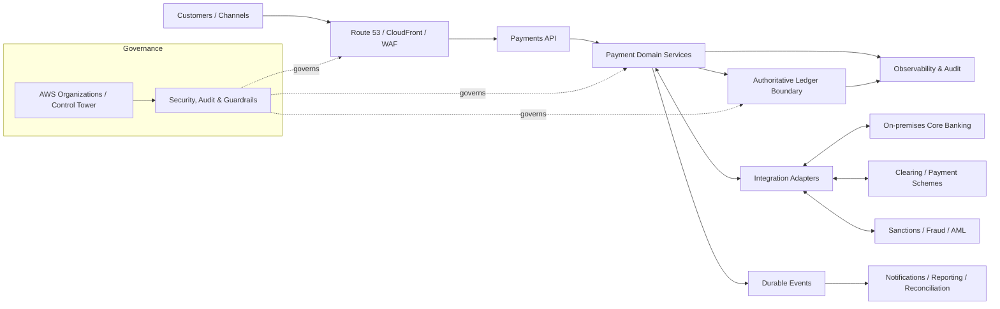
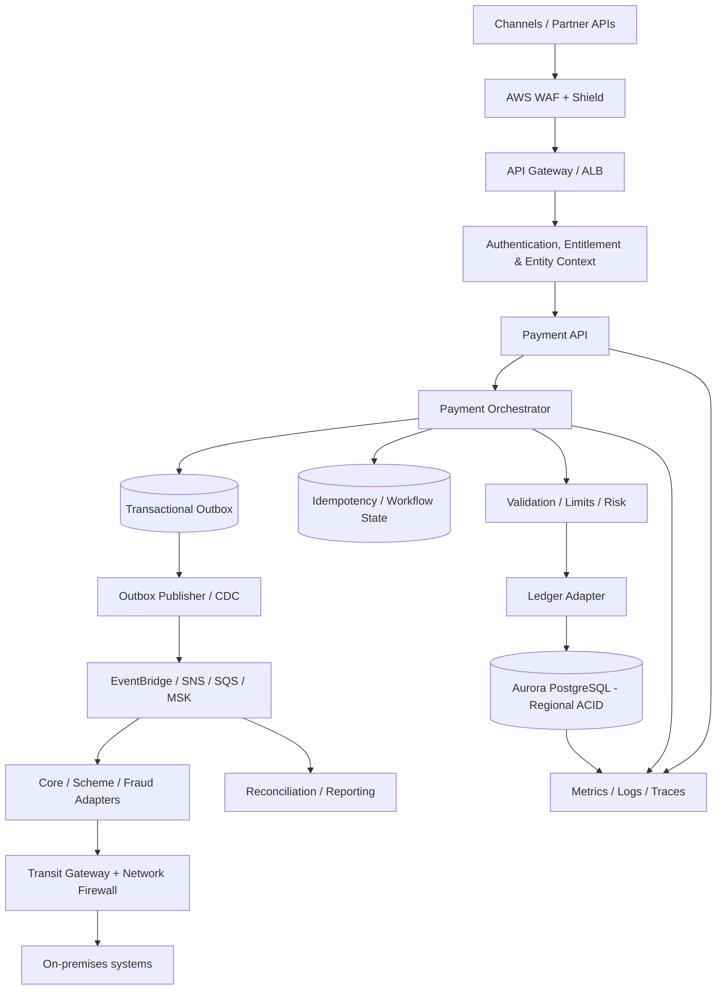
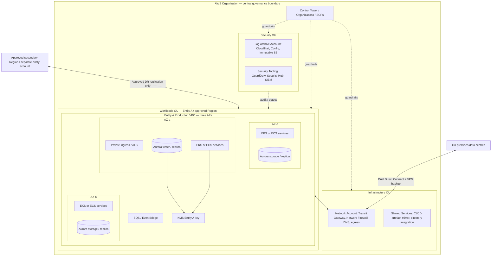
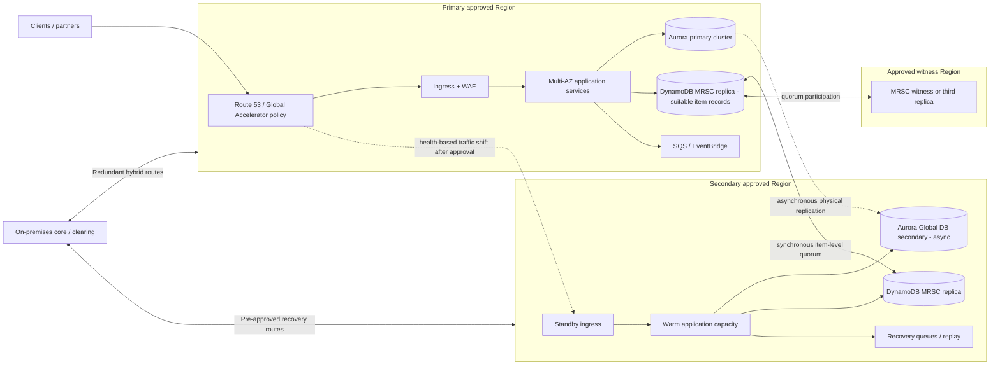
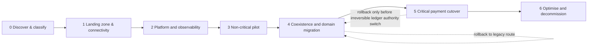

# Architecture Diagrams

All diagrams use the same names as the written design. Render in GitHub using Mermaid support. For a formal submission, export SVG/PNG from Mermaid CLI and check readability at normal zoom.

## A. Context diagram

## B. Logical architecture

## C. Deployment and trust-boundary diagram

## D. Regional DR diagram

## E. Migration roadmap

## Diagram notes

- Entity A is illustrative. Replicate the account/VPC/key/data pattern for each legal entity and approved Region; do not imply all entities share the same data plane.
- Region R3 is only used for DynamoDB MRSC quorum if it is in the permitted MRSC Region set and approved for the data class. A witness is not an application serving Region.
- Aurora Global Database is asynchronous cross-Region replication. The diagram intentionally does not imply zero RPO for Aurora.
- Exact service placement, ingress pattern, Region, number of AZs and route tables require implementation-level validation.
